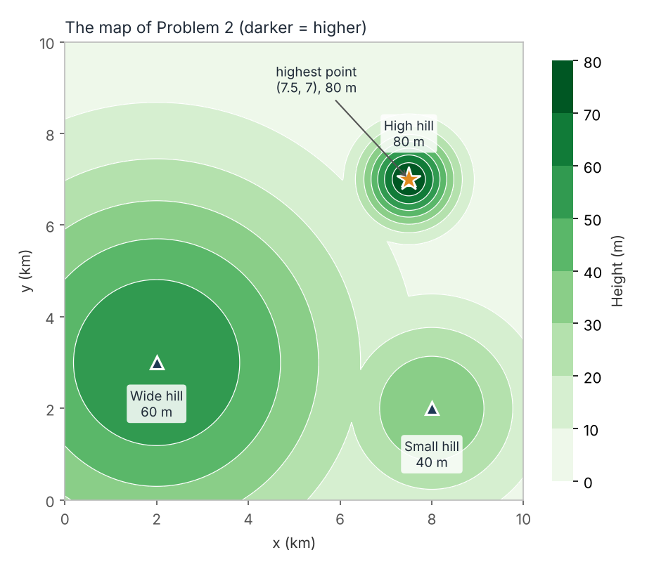

# Problem 2: The Highest Hill for a Weather Station

A town wants to build a weather station on the **highest point** of a hilly area.
The area is a square map, 10 km × 10 km. A point on the map is (x, y), in km.

The map has three hills:

| Hill | Top (center) | Height of the top | Width |
|---|---|---|---|
| Wide hill | (2, 3) | 60 m | wide (3 km) |
| High hill | (7.5, 7) | 80 m | narrow (0.7 km) |
| Small hill | (8, 2) | 40 m | 1.5 km |

## What is the problem?

**Find the point (x, y) with the biggest height.**

Looking at the map, the answer is easy: the top of the high hill, at **(7.5, 7)**, with **80 m**.
But the bees **cannot see the map**. A bee can only stand on one point and measure its height,
like a hiker with an altimeter in thick fog.

## How is the height of a point found?

Each hill has the shape of a bell. At its top the height is the full height of the hill.
When you walk away from the top, the height goes down, slowly for a wide hill and fast for a narrow hill:

**height at the point (from one hill) = top × e−d² / (2 · width²)**

- **top** = the height of the top of the hill (60, 80 or 40 m). It is fixed.
- **d** = the distance from the bee's point to the top of the hill.
- **width** = how wide the hill is.

The result is the height of the ground **where the bee stands**, if only this hill existed.
At the top, d = 0, so the result is the full top height. Far from the top, the result is almost 0.

But the map has **three** hills. So how do we find the height of a point on the map?
This is your first task: the function `fitness()`. Use the map picture and the examples below to check your idea.

Examples:
- At (7.5, 7), the top of the high hill: d = 0, so the height is **80 m**.
- At (2, 3), the top of the wide hill: the height is **60 m**.
- At (5, 5), between the hills: the height is only about **29 m**.

## Why is it difficult?

The wide hill covers a big part of the map. Most random bees land on it and climb to its top (60 m).
There, every point nearby is **lower**, so the bees think they are at the best place.
This is a **local optimum**: a good place that is not the best place.

The high hill is narrow, so it is easy to miss. To find it, a bee must land near it by chance.

## How we use the algorithm

- A **site** is a point [x, y]. Fitness = the height. We want the **maximum**.
- This time each site has **2 variables**. A recruited bee moves x and y, each inside [value − a, value + a].
- n = 10 scout bees, m = 4 selected sites, n2 = 5, n1 = 2, a = 0.5, 20 rounds.

## Your task

Open `code/incomplete/2_weather_station.py` and complete every function marked with **TODO**:

- `fitness()`: the height of the map at a site (think about the 3 hills)
- `random_site()`: Step 0
- `choose_elite()`: Step 2, the average rule
- `recruit_point()`: one bee lands in the neighborhood [x − a, x + a]
- `search_near()`: Step 3, keep the fittest point
- `run_bees()`: the main loop with all the steps

Use the small tests at the bottom of the file to check each function.
When your code works, the program prints the best point of every round.
You can compare your work with the full solution in `code/2_weather_station.py`.

## Think about it

1. Look at the output of the full solution. In rounds 7 to 11 the best height stays at 60 m. Which hill are the bees on? Why don't they move?
2. In round 12 the best height jumps to 68.1 m. Which step found the high hill: Step 3 or Step 4? Why is this step important?
3. In round 13 the height is 80.0 m. Which step climbed to the top so fast?
4. Remove the line `random.seed(3)` and run the program 5 times. Does it always find the high hill?
5. What can you change so the bees find the high hill more often? Try more rounds, or more random bees (a bigger `N`).
